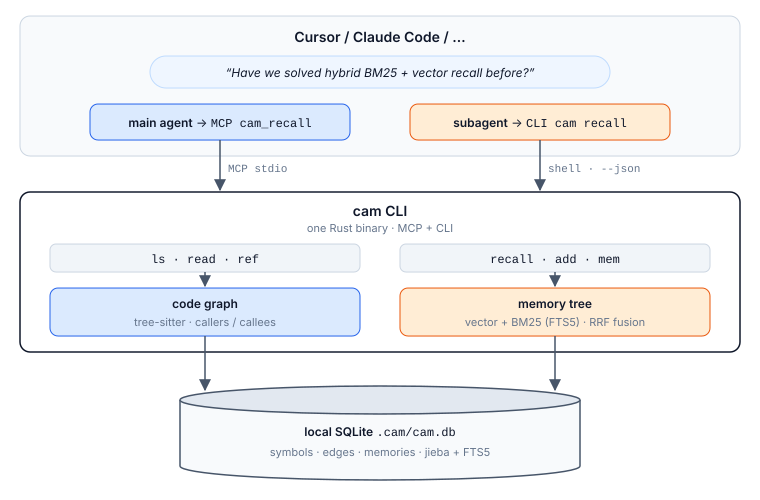
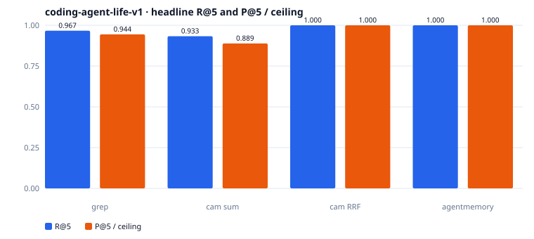
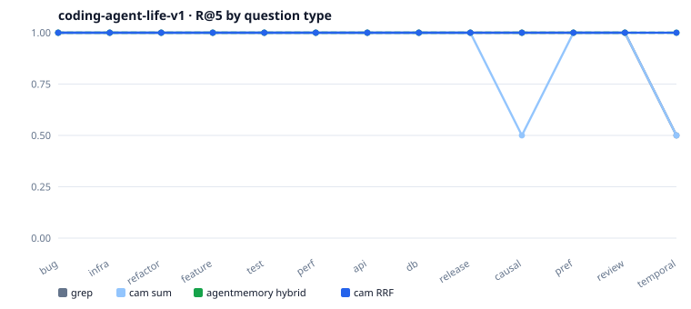
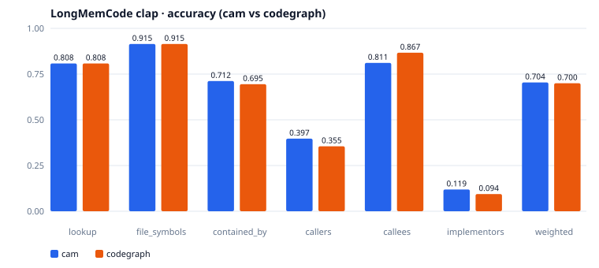
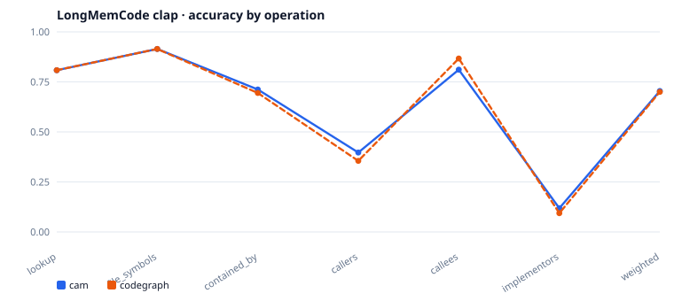
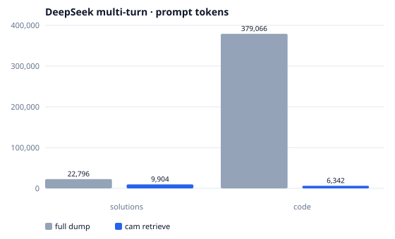
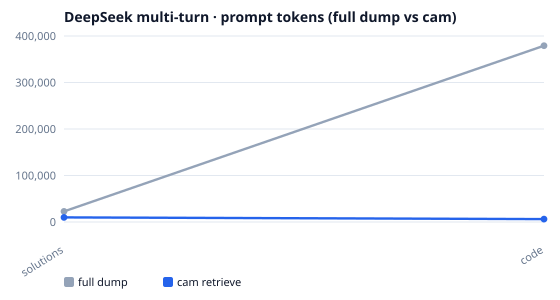

<div align="center">


# cam

[English](README.md) · [中文](README.zh.md) · [日本語](README.ja.md) · [한국어](README.ko.md) · [العربية](README.ar.md) · [🌐 Website](https://hanochzhu.github.io/cam-web/?lang=en)

### A local multi-turn conversational memory system purpose-built for coding agents

**Code graph + memory · surgical reads · 100% local · MCP + CLI**

**Kernel written in Rust**

[](https://hanochzhu.github.io/cam-web/?lang=en)
[](https://opensource.org/licenses/MIT)
[](https://www.rust-lang.org/)
[](#get-started)

[](#supported-platforms)
[](#supported-platforms)
[](#supported-platforms)

[](#supported-agents)
[](#supported-agents)
[](#supported-agents)
[](#supported-agents)
[](#supported-agents)
[](#supported-agents)
[](#supported-agents)
[](#supported-agents)

</div>

## Contents

- [Why cam?](#why-cam)
- [Get Started](#get-started)
- [Key Features](#key-features)
- [How It Works](#how-it-works)
- [Agent Workflow](#agent-workflow)
- [CLI Reference](#cli-reference)
- [Memory Rules](#memory-rules)
- [Configuration](#configuration)
- [Benchmarks](#benchmarks)
- [Supported Agents](#supported-agents)
- [Supported Languages](#supported-languages)
- [Supported Platforms](#supported-platforms)
- [License](#license)

Guides: [Interactive Showcase (Website)](https://hanochzhu.github.io/cam-web/?lang=en) · [Main Agent vs Subagent](docs/agents.md) · [MCP Configs by IDE](docs/mcp.md) · [中文说明](docs/agents.zh.md)

---

## Why cam?

When an AI coding agent explores a repository, it usually rediscovers structure the slow way — running `grep`, `glob`, and full-file `Read` one file at a time — and forgets everything in the next session.

**`cam` gives the agent two local retrieval planes in a single binary:**

| Plane | What it stores | How the agent uses it |
| --- | --- | --- |
| **Code Graph** | Tree-sitter symbols (functions, types, methods) as a virtual filesystem + 1-hop callers/callees | `ls`, `find`, `read src/file.rs/symbol`, `ref symbol --dir in\|out` — surgical symbol reads instead of whole-file dumps |
| **Memory Tree** | Project facts, architecture decisions, debugging write-ups, and user habits | `recall` (Vector + BM25 fused with RRF) and `add` (with branching `--parent` and revision `--supersedes`) |

> **One binary, two interfaces:** The **main agent** calls `cam` over **MCP** (`cam mcp`); **subagents** (which rarely inherit MCP tools) call the exact same **CLI** (`cam --json …`). Both share `.cam/cam.db` on disk, 100% local, zero API cost.

---

## Get Started

### Option 1: One-Sentence Agent Install (Recommended)

Paste this prompt directly into your coding agent (**Cursor**, **Claude Code**, **Codex**, **Windsurf**, **GitHub Copilot**, **Cline**, etc.) and let it install, index, and wire `cam` for you:

```text
Install cam from https://github.com/HanochZhu/codeagent_memory: require a working Rust toolchain (rustup), run `cargo install --git https://github.com/HanochZhu/codeagent_memory --locked`, ensure ~/.cargo/bin (or %USERPROFILE%\.cargo\bin on Windows) is on PATH, then verify with `cam --help`. In this repo run `cam index`. For the main agent, register MCP stdio: command `cam`, args `["mcp"]` (Cursor: .cursor/mcp.json; Claude Code: .mcp.json). Subagents call `cam --json` in the shell. Do not add extra docs.
```

<details>
<summary><b>How each IDE / agent handles this prompt</b></summary>

| Environment | What to do |
| --- | --- |
| **Cursor / Windsurf / Claude Code / Codex** | Paste into Agent / Chat; the agent runs the terminal install, builds `.cam/cam.db`, and writes the MCP config |
| **VS Code** (Copilot / Continue / Cline) | Paste into Agent / Chat mode with terminal access enabled |
| **JetBrains** (IntelliJ / RustRover / GoLand) | Paste into AI Assistant, or run `cargo install` in the built-in terminal |

<sub>Note: `cargo install` places `cam` in `~/.cargo/bin` (Windows: `%USERPROFILE%\.cargo\bin`). Restart your terminal or IDE if `cam` is not immediately found on `PATH`.</sub>

</details>

---

### Option 2: Manual Setup

#### 1. Install the CLI

Requires a [Rust toolchain](https://rustup.rs/):

```bash
cargo install --git https://github.com/HanochZhu/codeagent_memory --locked
cam --help
```

<details>
<summary><b>Alternative: Build from local clone or run via Docker</b></summary>

**From a local clone:**

```bash
git clone https://github.com/HanochZhu/codeagent_memory.git
cd codeagent_memory
cargo install --path . --locked
```

**Docker (no Rust toolchain required):**

```bash
docker pull ghcr.io/hanochzhu/codeagent-memory:0.1.6
docker run -i --rm -v "$PWD:/work" -w /work ghcr.io/hanochzhu/codeagent-memory:0.1.6
```

Or build locally: `docker build -t cam https://github.com/HanochZhu/codeagent_memory.git`

</details>

#### 2. Index & query your project

```bash
cd your-project
cam index                                              # parse repo into .cam/cam.db

# Query the code graph
cam ls src/                                            # list files or symbols in a file
cam read src/main.rs/main                              # read a single symbol body
cam ref main --dir in                                  # 1-hop callers (in) or callees (out)

# Query & write to the memory tree
cam recall "how does hybrid recall fuse BM25 and vectors"
cam add --summary "..." < notes.md
```

<sub>`cam` auto-initializes `.cam/` on first use. Run `cam watch` in the background if you want live incremental graph updates as files change.</sub>

#### 3. Connect MCP for the main agent

Add `cam mcp` to your host's MCP configuration (e.g. `.cursor/mcp.json` or `.mcp.json`):

```json
{
  "mcpServers": {
    "cam": {
      "command": "cam",
      "args": ["mcp"]
    }
  }
}
```

See [docs/mcp.md](docs/mcp.md) for host-specific config paths and [docs/agents.md](docs/agents.md) for main-agent / subagent prompt rules.

<sub>The first `recall` or `add` downloads the default embedding model (`potion-multilingual-128M` to `~/.cam/models/`) and falls back to a lexical hash embedder if offline.</sub>

---

## Key Features

| Feature | Details |
| --- | --- |
| **SQLite Code Graph** | Tree-sitter parses functions, types, and call edges into `.cam/cam.db` for instant symbol-level navigation |
| **Virtual Paths** | `src/main.rs` addresses a file outline; `src/main.rs/main` addresses the symbol body directly |
| **Live Incremental Sync** | `cam sync` hashes file contents; `cam watch` keeps the graph updated on save |
| **Hybrid Recall (RRF)** | Combines local dense embeddings (`model2vec`) + identifier-aware BM25 via Reciprocal Rank Fusion ($k=60$) |
| **Revision Chains & Tree** | `--parent` builds branching topic hierarchies; `--supersedes` links linear revisions and folds older entries automatically |
| **Ebbinghaus Retention** | Retention $R = e^{-t / S}$ gently weights ranking ($\le 10\%$) and flags `stale` / `needs_update` memories without deleting history |
| **Dual Interface (MCP + CLI)** | Main agent uses `cam_*` MCP tools; subagents run `cam --json …` in the shell |
| **100% Local & Private** | Zero external API keys; runs entirely on local SQLite and on-disk embeddings |
| **9 Languages** | Rust, Python, TypeScript, JavaScript, Go, Java, C, C++, C# |

---

## How It Works



1. **Extract** — `tree-sitter` walks the workspace and stores symbol definitions and call edges in `.cam/cam.db`.
2. **Surgical Read** — Agents navigate via virtual paths (`ls` → `find` → `read` → `ref`). Reading a file returns its symbol outline; reading `file/symbol` returns only that symbol's source slice.
3. **Hybrid Recall** — `recall` takes an English query, embeds it locally, runs identifier-aware BM25 (splitting `snake_case`, `kebab-case`, `camelCase` + English stemming), prunes low-confidence tails, and fuses both lists with **RRF** ($k=60$) scaled by $0.9 + 0.1 \times R$. Superseded revisions are automatically expanded to their newest replacement.
4. **Write-Back** — When an agent solves a non-trivial task, it extracts atomic facts so each `add` stores only one fact (English summary; body supports non-Latin characters). Related facts are connected via `--link` / `links` into a knowledge graph (inspected via `mem show`; recall does not traverse graph links yet). `--parent` attaches a memory to a structural topic; `--supersedes` replaces an outdated memory while preserving lineage.

Architecture deep dive (Chinese): [DESIGN.md](DESIGN.md).

---

## Agent Workflow

Every coding task follows the same four-step loop:

1. **Recall first** — Query `cam_recall` / `cam recall` in English before grepping. Reuse a hit if it is `latest` and not `needs_update`.
2. **Ensure indexed** — If graph tools return `not_indexed`, run `cam_index` / `cam index` once for the project.
3. **Walk the graph** — On a memory miss, locate symbols with `find` or `ls`, read symbol bodies with `read <file>/<symbol>`, and trace callers/callees with `ref <symbol> --dir in|out`.
4. **Write back** — Persist newly discovered architecture facts or fixes with `cam_add` / `cam add` as atomic facts (one fact per memory, English summary; body supports non-Latin characters), linking related facts with `links` / `--link`.

| Role | Interface | Typical Usage |
| --- | --- | --- |
| **Main Agent** (Chat / IDE session) | **MCP** (`cam mcp`) | Calls `cam_recall`, `cam_find`, `cam_ls`, `cam_read`, `cam_ref`, `cam_add`, `cam_mem_tree`, `cam_mem_show` directly |
| **Subagent** (Task / explore / CLI) | **CLI** (`cam --json`) | Runs `cam --json --project <dir> <cmd>` in the shell (subagents rarely inherit MCP tools) |

Full agent rules & copy-paste system prompts: [docs/agents.md](docs/agents.md).

---

## CLI Reference

### Code Graph Commands

| Command | Description |
| --- | --- |
| `cam index` | Parse the project with tree-sitter into `.cam/cam.db` (creates `.cam/` if needed) |
| `cam sync` | Incrementally update the graph for modified files using content hashes |
| `cam watch [--debounce-ms N]` | Watch source files and auto-sync (`--json` streams one JSON report per sync) |
| `cam ls [virt_path]` | List directories, files, or symbols inside a file |
| `cam read <virt_path> [--full]` | Read a file's symbol outline, a specific symbol body (`path/symbol`), or the `--full` file |
| `cam find <query> [--kind K] [--file S] [--scope D] [--limit N]` | Case-insensitive substring search over symbol names (exact matches first, then prefixes) |
| `cam ref <symbol> --dir in\|out [--file S] [--kind K] [--scope D]` | 1-hop callers (`in` / `--callers`) or callees (`out` / `--callees`). Returns ranked `candidates` on ambiguous names |

### Memory Commands

| Command | Description |
| --- | --- |
| `cam recall "<query>" [--limit N] [--no-expand] [--include-superseded] [--snippets]` | Hybrid RRF recall (English query). `--no-expand` skips newest-revision expansion; `--include-superseded` keeps old revisions; `--snippets` clips long bodies below rank 1 |
| `cam add --summary "..." [--parent ID] [--supersedes ID] [--link ID]... [--body TEXT \| --file PATH]` | Store one atomic fact as a memory (English summary required; body supports non-Latin characters; via `--body`, `--file`, or `stdin`). `--link` connects related facts in the knowledge graph; `--parent` for topic hierarchy; `--supersedes` to replace an older memory |
| `cam mem tree` | Render the memory hierarchy and revision chains |
| `cam mem show <id>` | Inspect a single memory entry in full |

### Server & Configuration Commands

| Command | Description |
| --- | --- |
| `cam mcp` | Start the stdio MCP server for the main agent (see [docs/mcp.md](docs/mcp.md)) |
| `cam status` | Show resolved project root, database path, node/edge/memory counts, and active config |
| `cam config get` | Print current `~/.cam/config.toml` settings |
| `cam config set stale_days <N>` | Set age threshold (in days) for marking memories `stale` |
| `cam config set embedding_model <model>` | Set Hugging Face model2vec repo, local model directory, `hash`, or `default` |

**Global flags & conventions:**
- `--project <dir>` (or `CAM_PROJECT` env var) overrides automatic upward `.cam` / `.git` root detection.
- `--json` emits compact JSON (`--pretty` for indented JSON). Errors on `--json` print `{"error":{"code":…,"message":…}}` to `stdout` and exit non-zero.
- **Ambiguous symbols:** When `read` or `ref` matches multiple definitions, `cam` returns `status: "ambiguous"` with candidate node IDs (e.g. `src/main.rs:function:main:12`) that can be passed directly back to `read` or `ref`.
- **Ignore rules & multi-repo directories:** Honors `.gitignore` and `.camignore` at any depth. A nested directory with its own `.git` (standalone clone, submodule, or linked worktree) is indexed into that directory's `.cam/cam.db`. The parent database keeps a catalog of those graphs and queries fan out into them, so opening the nested directory reuses the graph. `cam ls` lists them as `kind: "project"` (passable to `--scope`).

---

## Memory Rules

- **Atomic facts & knowledge graph links:** Store only one atomic fact per memory to avoid packing excessive information into a single entry. When multiple facts are related, link them with `--link` / `links` to form a knowledge graph (graph recall is not enabled yet).
- **English queries and summaries:** Recall queries and memory summaries must be written in English. Memory bodies support non-Latin characters.
- **Retention & reinforcement:** Ebbinghaus retention $R = e^{-t / S}$ adjusts recall score via $\text{relevance} \times (0.9 + 0.1 \times R)$. Entries with $R < 0.3$ are marked `needs_update`; entries older than `stale_days` (default `30`) are marked `stale`. Every valid recall hit (`needs_update = false`) refreshes last-accessed time and multiplies stability $S$ by `1.7`.
- **Non-destructive lineage:** Memories are never deleted. `--parent` forms branching trees; `--supersedes` forms linear revision chains where only the tail is marked `latest` and older revisions are folded out of default recall results.

---

## Configuration

Global settings live in `~/.cam/config.toml`:

```toml
stale_days = 30
# embedding_model = "minishlab/potion-multilingual-128M" # default (cached under ~/.cam/models/)
# embedding_model = "minishlab/potion-base-8M"           # lighter Hugging Face model2vec repo
# embedding_model = "/path/to/local/model2vec"           # dir with tokenizer.json, config.json, model.safetensors
# embedding_model = "hash"                               # zero-download lexical hash embedder
```

Use `CAM_EMBED_MODEL` to override the model for a single process, or `cam config set embedding_model default` to reset. When the embedding model changes, the next `recall` automatically re-embeds existing memories before scoring.

---

## Benchmarks

`cam` evaluates its code graph and memory planes separately against the closest open-source systems **on identical corpora**:

| Plane | Baseline / Analogue | Benchmark Corpus | Headline Takeaway |
| --- | --- | --- | --- |
| **Memory** | [agentmemory](https://github.com/rohitg00/agentmemory) hybrid + tokenized `grep` | [coding-agent-life-v1](eval/coding_life/README.md) | **1.000 R@5 / 0.240 P@5** (matches hybrid ceiling, **1.000 newest R@5** on revision chains) |
| **Long-term Memory** | BM25 / dense retrievers | [LongMemEval-S](https://github.com/xiaowu0162/LongMemEval) | **0.909 R@5 / 0.980 Hit@5 / 0.840 MRR** with `potion-multilingual-128M` |
| **Code Graph** | [codegraph](https://github.com/colbymchenry/codegraph) v0.9.6 | [LongMemCode](eval/longmemcode/README.md) (`clap`) | **0.769** vs 0.768 on supported 1-hop tasks, P95 ≈ 5.2 ms, `$0` |
| **Workflow Retrieval** | Lexical / BM25 file retrieval | [Agent Retrieval Bench V2](https://agent-retrieval-bench.github.io/) `edit2ripple` | **0.297 MRR** (best first-hit rank, P95 7.3 ms) |
| **Multi-turn Tokens** | Full context dump | [DeepSeek multi-turn](eval/llm_multiturn/README.md) | **57% fewer tokens** on memory track, **98% fewer tokens** on code track |

<sub>General chat memory frameworks (Mem0, Zep, Letta) target conversational logs rather than these coding-agent corpora and are omitted from the tables below.</sub>

### System Comparison

| | **cam** | **agentmemory** | **codegraph** |
| --- | --- | --- | --- |
| **What it stores** | Code graph + memory tree | Session / chat memories | Code graph |
| **Query primitives** | `recall` / `ls` / `find` / `read` / `ref` | `smart-search` / `remember` | `explore` / callers / callees |
| **Interface** | **MCP + CLI** | MCP + REST + hooks | MCP + CLI |
| **Ranking / Fusion** | Vector + BM25 + **RRF** + retention | BM25 + embed + rerank | FTS5 + graph walk |
| **Cost** | 100% local (`$0`) | Local server | Local |

### 1. Memory — `coding-agent-life-v1`

15 sessions, 15 queries, $k=5$ (same scoring as `agentmemory` `score.ts`; P@5 ceiling is `0.240`).

| System | Hit Rate | R@5 | P@5 | Source |
| --- | --- | ---: | ---: | --- |
| `grep` (tokenized substring) | 15 / 15 | 0.967 | 0.227 | this repo, 2026-09-23 |
| `cam` min-max sum (legacy) | 15 / 15 | 0.933 | 0.213 | historical, hash embed |
| **`cam` RRF** | **15 / 15** | **1.000** | **0.240** | this repo, hash embed |
| `agentmemory` hybrid | 15 / 15 | 1.000 | 0.240 | published v0.9.26 |





**Revision chains (`--lineage`):** Re-ingesting every turn as a `--supersedes` revision tests whether top-$k$ returns the newest node of each gold chain (**newest R@k**) and whether any superseded node falsely claims `latest` (**stale `latest`**).

| k | R@k | P@k | newest R@k | stale `latest` |
| ---: | ---: | ---: | ---: | ---: |
| 5 | 1.000 | 0.240 | **1.000** | **0** |
| 10 | 1.000 | 0.120 | **1.000** | **0** |

### 2. Long-Term Memory — `LongMemEval-S`

100 non-abstention questions sampled with seed 42 from cleaned `LongMemEval-S`. Retrieval fuses embeddings + BM25 with RRF at $k=10$ without an LLM reader.

| Embedder | R@1 | R@5 | R@10 | Hit@1 | Hit@5 | Hit@10 | MRR | Retrieval P50 / P95 |
| --- | ---: | ---: | ---: | ---: | ---: | ---: | ---: | ---: |
| `hash` (offline test) | 0.382 | 0.803 | 0.922 | 0.580 | 0.910 | 0.970 | 0.718 | 24.1 / 35.5 ms |
| **`potion-multilingual-128M`** | **0.474** | **0.909** | **0.952** | **0.740** | **0.980** | **0.990** | **0.840** | 1.12 / 1.34 s |

### 3. Workflow Retrieval — Agent Retrieval Bench V2 (`edit2ripple`)

58 anchored-change queries across 44 frozen repository snapshots (no LLM; BCY = Budgeted Context Yield under the canonical 8K-token file-packing protocol).

| System | Recall@5 | Recall@10 | Recall@20 | MRR | BCY@8k |
| --- | ---: | ---: | ---: | ---: | ---: |
| **`cam` graph** | 0.300 | 0.335 | 0.378 | **0.297** | 0.300 |
| Lexical | **0.412** | **0.536** | **0.588** | 0.243 | **0.447** |
| BM25 | 0.207 | 0.287 | 0.499 | 0.154 | 0.243 |

`cam` graph achieves the highest first-hit rank (MRR `0.297`, query P95 `7.3 ms`), while lexical search provides broader multi-file coverage — motivating graph + lexical rank fusion.

### 4. Code Graph — LongMemCode (`clap`)

`clap` v4.6.1, 536 scenarios against SCIP gold (no LLM, P95 ≈ 5.2 ms, `$/1k` = 0).

| Slice | n | `cam` | `codegraph` 0.9.6 |
| --- | ---: | ---: | ---: |
| **Supported (1-hop)** | 478 | **0.769** | 0.768 |
| `lookup` / `file_symbols` | 293 / 55 | 0.808 / 0.915 | 0.808 / 0.915 |
| `callers` / `callees` | 67 / 18 | **0.397** / 0.811 | 0.355 / **0.867** |
| `implementors` | 40 | **0.119** | 0.094 |
| Raw / Weighted (all 536) | 536 | **0.709** / **0.704** | 0.704 / 0.700 |





### 5. Multi-Turn Token Savings — DeepSeek

Full context dump vs. per-turn `cam` retrieval (`deepseek-flash`, hash embedder, 2026-10-13):

| Track | n | Full Acc. | `cam` Acc. | Full Tokens | `cam` Tokens | Token Saving |
| --- | ---: | ---: | ---: | ---: | ---: | ---: |
| **Memory** (`coding-agent-life`) | 15 | 1.00 | 0.87 | 22,796 | 9,904 | **57%** (1,471 → 616 / turn) |
| **Code** (this repo indexed) | 6 | 0.83 | 0.33 | 379,066 | 6,342 | **98%** (63,076 → 1,000 / turn) |





<details>
<summary><b>Reproduce all benchmarks</b></summary>

Dataset paths are configured in [eval/datasets.toml](eval/datasets.toml) (`coding-agent-life-v1` defaults to `../agentmemory` or `CAM_EVAL_CODING_LIFE`).

```bash
python3 eval/coding_life/run.py --adapter grep
python3 eval/coding_life/run.py                                             # potion; errors if the model fails
python3 eval/coding_life/run.py --hash-embed                                # hash embedder
python3 eval/longmemeval/run.py --sample 100 --seed 42 --workers 8          # potion
python3 eval/longmemeval/run.py --sample 100 --seed 42 --workers 8 --hash-embed
python3 eval/locomo/run.py --workers 4                                      # potion, evidence recall

git clone --depth 1 https://github.com/eyuansu62/agent-retrieval-bench \
  eval/agent_retrieval/vendor/agent-retrieval-bench
python3 -m pip install -e eval/agent_retrieval/vendor/agent-retrieval-bench
arb download-benchmark --version v2_edit2ripple --local-dir eval/agent_retrieval/data --force
python3 eval/agent_retrieval/run.py --workers 8

python3 eval/llm_multiturn/run.py --track both   # potion; requires DEEPSEEK_API_KEY
python3 eval/longmemcode/run.py --corpus clap
python3 eval/charts/generate.py
```

</details>

---

## Supported Agents

Register `cam mcp` (stdio) for the **main agent**; **subagents** use the `cam --json` CLI directly with zero extra setup.

| Host | MCP Configuration | Subagent / Notes |
| --- | --- | --- |
| **Cursor** | `.cursor/mcp.json`, `~/.cursor/mcp.json`, or `.cursor-plugin/plugin.json` | `Task` / `explore` subagents use CLI |
| **Claude Code** | `.mcp.json`, `~/.claude.json`, or `claude mcp add cam -- cam mcp` | Limited-tool subagents use CLI |
| **Codex** | `~/.codex/config.toml` → `[mcp_servers.cam]` | `codex exec` uses CLI |
| **Windsurf** | `~/.codeium/windsurf/mcp_config.json` | Cascade uses MCP |
| **GitHub Copilot** | `.vscode/mcp.json` or `~/.copilot/mcp-config.json` | Chat uses MCP; CLI scripts use CLI |
| **Continue / Cline** | `~/.continue/config.yaml` / `~/.cline/mcp.json` | |
| **JetBrains** | AI Assistant → MCP (`cam` / `mcp`) | Use absolute path to `cam` if IDE `PATH` is empty |
| **Gemini CLI / Antigravity / OpenCode / Zed / Droid** | See [docs/mcp.md](docs/mcp.md) | |

Copy-paste configs: [docs/mcp.md](docs/mcp.md) · System prompts: [docs/agents.md](docs/agents.md).

---

## Supported Languages

| Language | Extensions | Indexed Nodes & Edges |
| --- | --- | --- |
| **Rust** | `.rs` | functions, structs, enums, traits, calls |
| **Python** | `.py` | functions, classes, calls |
| **TypeScript** | `.ts`, `.tsx` | functions, methods, classes, calls |
| **JavaScript** | `.js`, `.jsx` | functions, methods, classes, calls |
| **Go** | `.go` | functions, methods, structs, calls |
| **Java** | `.java` | functions, methods, classes, interfaces, calls |
| **C** | `.c` | functions, structs, calls |
| **C++** | `.cc`, `.cpp`, `.cxx`, `.h`, `.hpp` | functions, methods, classes, structs, calls |
| **C#** | `.cs` | functions, methods, classes, interfaces, calls |

---

## Supported Platforms

`cam` compiles natively on **macOS**, **Linux**, and **Windows** via `cargo install --git https://github.com/HanochZhu/codeagent_memory --locked`, or runs anywhere via Docker (`ghcr.io/hanochzhu/codeagent-memory:0.1.6`). See [Get Started](#get-started).

---

## License

MIT

---

<div align="center">

**Made for AI coding agents — Claude Code, Cursor, Codex, Windsurf, Copilot, and JetBrains**

[Report Bug](https://github.com/HanochZhu/codeagent_memory/issues) · [Request Feature](https://github.com/HanochZhu/codeagent_memory/issues)

</div>
