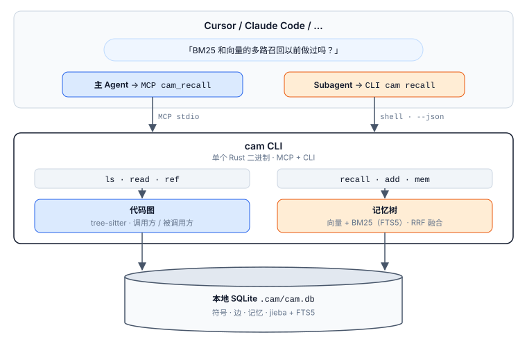

<div align="center">


# cam

[English](README.md) · [中文](README.zh.md)

### 专为 AI 编程 Agent 打造的本地多轮对话记忆系统

**代码图 + 记忆 · 按符号读代码 · 100% 本地 · MCP + CLI**

**内核用 Rust 写成**

[](https://opensource.org/licenses/MIT)
[](https://www.rust-lang.org/)
[](#开始)

[](#支持的平台)
[](#支持的平台)
[](#支持的平台)

[](#支持的-agent)
[](#支持的-agent)
[](#支持的-agent)
[](#支持的-agent)
[](#支持的-agent)
[](#支持的-agent)
[](#支持的-agent)
[](#支持的-agent)

</div>

## 目录

- [为什么需要 cam？](#为什么需要-cam)
- [开始](#开始)
- [能力](#能力)
- [原理](#原理)
- [Agent 怎么用](#agent-怎么用)
- [命令一览](#命令一览)
- [记忆规则](#记忆规则)
- [配置](#配置)
- [评测](#评测)
- [支持的 Agent](#支持的-agent)
- [支持的语言](#支持的语言)
- [支持的平台](#支持的平台)
- [许可证](#许可证)

详细用法：[主 Agent 与 Subagent](docs/agents.zh.md) · [各 IDE 的 MCP 配置](docs/mcp.zh.md) · [English](docs/agents.md)

---

## 为什么需要 cam？

AI 编程 Agent 探索仓库时，通常靠 `grep`、`glob` 和整文件 `Read` 一份份翻找结构；到了下一轮对话又全部遗忘、重来一遍。

**`cam` 用一个本地二进制为 Agent 提供两个检索平面：**

| 平面 | 存什么 | Agent 怎么用 |
| --- | --- | --- |
| **代码图（Code Graph）** | 基于 tree-sitter 的文件/符号虚拟文件系统 + 一跳 callers/callees | `ls`、`find`、`read src/file.rs/symbol`、`ref symbol --dir in\|out` —— 按符号精准切片，不再整文件塞进上下文 |
| **记忆树（Memory Tree）** | 项目事实、架构决策、排障结论与用户习惯 | `recall`（向量 + BM25 以 RRF 融合召回）与 `add`（`--parent` 结构分层、`--supersedes` 版本迭代） |

> **一个二进制，两扇门：** **主 Agent** 通过 **MCP**（`cam mcp`）直接调用工具；通常拿不到 MCP 的 **Subagent** 在终端跑同一套 **CLI**（`cam --json …`）。两者共享项目下的 `.cam/cam.db`，100% 本地，零 API 费用。

---

## 开始

### 方式一：让 Agent 一句话自动安装（推荐）

直接把下面这段话复制粘贴给你的 AI 编程助手（**Cursor**、**Claude Code**、**Codex**、**Windsurf**、**GitHub Copilot**、**Cline** 等），它会自动完成编译安装、项目建图与 MCP 接入：

```text
请从 https://github.com/HanochZhu/codeagent_memory 安装 cam：先确认本机有 rustup/cargo，执行 `cargo install --git https://github.com/HanochZhu/codeagent_memory --locked`，把 ~/.cargo/bin（Windows 为 %USERPROFILE%\.cargo\bin）加入 PATH，用 `cam --help` 验证。然后在当前仓库执行 `cam index`。给主 Agent 注册 MCP stdio：command 为 `cam`，args 为 `["mcp"]`（Cursor：.cursor/mcp.json；Claude Code：.mcp.json）。Subagent 在 shell 里跑 `cam --json`。不要额外写说明文档。
```

<details>
<summary><b>各 IDE / Agent 中如何使用这段话</b></summary>

| 环境 | 用法 |
| --- | --- |
| **Cursor / Windsurf / Claude Code / Codex** | 粘贴到 Agent / Chat 对话框，它会自动在终端安装、生成 `.cam/cam.db` 并写入 MCP 配置 |
| **VS Code**（Copilot / Continue / Cline） | 在开启终端权限的 Agent / Chat 模式下粘贴 |
| **JetBrains**（IntelliJ / RustRover / GoLand） | 粘贴给 AI Assistant，或在内置终端手动执行下方安装命令 |

<sub>提示：`cargo install` 会把 `cam` 安装到 `~/.cargo/bin`（Windows：`%USERPROFILE%\.cargo\bin`）。若当前终端提示找不到命令，重新打开终端或重启 IDE 即可。</sub>

</details>

---

### 方式二：手动安装与配置

#### 1. 安装 CLI

需先安装 [Rust 工具链（rustup）](https://rustup.rs/)：

```bash
cargo install --git https://github.com/HanochZhu/codeagent_memory --locked
cam --help
```

<details>
<summary><b>其它安装方式：本地克隆编译 / Docker</b></summary>

**从本地克隆编译：**

```bash
git clone https://github.com/HanochZhu/codeagent_memory.git
cd codeagent_memory
cargo install --path . --locked
```

**Docker（无需本机安装 Rust）：**

```bash
docker pull ghcr.io/hanochzhu/codeagent-memory:0.1.5
docker run -i --rm -v "$PWD:/work" -w /work ghcr.io/hanochzhu/codeagent-memory:0.1.5
```

或从源码构建镜像：`docker build -t cam https://github.com/HanochZhu/codeagent_memory.git`

</details>

#### 2. 建图与查询

```bash
cd your-project
cam index                                              # 解析仓库写入 .cam/cam.db

# 查代码图
cam ls src/                                            # 列出目录、文件或文件内符号
cam read src/main.rs/main                              # 只读指定符号的源码
cam ref main --dir in                                  # 查一跳 callers (in) 或 callees (out)

# 查记忆与写回结论
cam recall "how does hybrid recall fuse BM25 and vectors"
cam add --summary "..." < notes.md
```

<sub>`cam` 首次执行时会自动初始化 `.cam/`。如需随文件保存自动增量更新代码图，可在后台运行 `cam watch`。</sub>

#### 3. 为主 Agent 接入 MCP

将以下配置加入宿主的 MCP 配置文件（如 Cursor 的 `.cursor/mcp.json` 或 Claude Code 的 `.mcp.json`）：

```json
{
  "mcpServers": {
    "cam": {
      "command": "cam",
      "args": ["mcp"]
    }
  }
}
```

各 IDE 的详细配置文件路径见 [docs/mcp.zh.md](docs/mcp.zh.md)，主 Agent 与 Subagent 的分工说明见 [docs/agents.zh.md](docs/agents.zh.md)。

<sub>首次执行 `recall` 或 `add` 时会自动下载默认嵌入模型 `potion-multilingual-128M`（缓存在 `~/.cam/models/`）；若离线或不可用则自动回退到词面 hash embedder。</sub>

---

## 能力

| 特性 | 说明 |
| --- | --- |
| **SQLite 代码图** | tree-sitter 解析函数、类型与调用边写入 `.cam/cam.db`，无需打开整文件即可定位与跳转 |
| **虚拟路径寻址** | `src/main.rs` 指向文件大纲；`src/main.rs/main` 直接指向该文件内的符号源码 |
| **增量同步与监听** | `cam sync` 按内容哈希增量更新；`cam watch` 监听源文件变动自动同步 |
| **多路混合召回（RRF）** | 本地稠密向量（`model2vec`）+ 标识符分词 BM25，通过 **RRF**（$k=60$）融合排序 |
| **版本链与记忆树** | `--parent` 构建可分叉的主题树；`--supersedes` 建立线性替代修订并自动折叠旧版 |
| **艾宾浩斯保留率** | $R = e^{-t / S}$ 温和调节排序分（幅度 $\le 10\%$），对过期和遗忘条目打标（`stale` / `needs_update`），永不删历史 |
| **MCP + CLI 双接口** | 主 Agent 调 `cam_*` MCP 工具；Subagent 调 `cam --json …`，共用同一套内核 |
| **100% 本地隐私** | 无需任何外部 API Key，数据与模型全部保存在本地磁盘 |
| **支持 9 种语言** | Rust、Python、TypeScript、JavaScript、Go、Java、C、C++、C# |

---

## 原理



1. **抽取（Extraction）** — `tree-sitter` 遍历项目，将符号定义（函数、类型）和调用边写入 `.cam/cam.db`。
2. **按需读（Surgical Read）** — 通过虚拟路径（`ls` → `find` → `read` → `ref`）浏览代码。`read` 默认返回文件符号大纲或单个符号切片，加 `--full` 才读取整文件。
3. **混合召回（Recall）** — `recall` 接收英文查询，同时执行向量检索与标识符感知的 BM25（自动切分 `snake_case`、`kebab-case`、`camelCase` 并提取英文词干），截断各路低分尾部后用 **RRF**（$k=60$）融合，并乘以保留率系数 $0.9 + 0.1 \times R$。命中旧修订时自动拉入最新替代版本并在 top-$k$ 前折叠旧版。
4. **写回（Write-Back）** — 解决完问题后，按原子事实提取记忆，每条 `add` 只存储一条事实（摘要要求英文，正文支持非拉丁字符）。多个相关事实之间通过 `--link` / `links` 建立连接构成知识图谱（可通过 `mem show` 查看，当前暂不做图召回）。`--parent` 挂载结构层级，`--supersedes` 替代旧结论同时保留历史脉络。

架构与设计细节见 [DESIGN.md](DESIGN.md)。

---

## Agent 怎么用

无论是主 Agent 还是 Subagent，都遵循统一的四步工作流：

1. **先 Recall** — 探索代码前先把问题转成一句英文调用 `cam_recall` / `cam recall`；若命中条目为 `latest` 且非 `needs_update`，直接复用。
2. **确认已建图** — 若代码图工具提示 `not_indexed`，在项目根跑一次 `cam_index` / `cam index`。
3. **按图索骥** — 未命中时，用 `find` 或 `ls` 找符号，用 `read <文件>/<符号>` 读实现，用 `ref <符号> --dir in|out` 查上下游调用。
4. **写回记忆** — 任务完成后，通过 `cam_add` / `cam add` 按原子事实记录关键结论（一条记忆只存一条事实，描述/摘要需为英文，正文支持非拉丁字符），多个相关事实之间用 `links` / `--link` 建立知识图谱连接。

| 角色 | 调用方式 | 典型用法 |
| --- | --- | --- |
| **主 Agent**（当前对话） | **MCP**（`cam mcp`） | 直接调用 `cam_recall`、`cam_find`、`cam_ls`、`cam_read`、`cam_ref`、`cam_add`、`cam_mem_tree`、`cam_mem_show` |
| **Subagent**（Task / explore / CLI） | **CLI**（`cam --json`） | 在终端执行 `cam --json --project <dir> <cmd>`（大多数宿主不会把 MCP 传给 Subagent） |

完整提示词模板与分工指南见 [docs/agents.zh.md](docs/agents.zh.md)。

---

## 命令一览

### 代码图命令

| 命令 | 作用 |
| --- | --- |
| `cam index` | 使用 tree-sitter 解析项目写入 `.cam/cam.db`（无 `.cam/` 时自动创建） |
| `cam sync` | 按文件内容哈希增量更新代码图 |
| `cam watch [--debounce-ms N]` | 监听源文件变动并自动 `sync`（`--json` 下每次同步输出一行 JSON） |
| `cam ls [virt_path]` | 列出目录、文件或文件内的符号 |
| `cam read <virt_path> [--full]` | 读取文件符号大纲、指定符号源码（`文件/符号`），或加 `--full` 读整文件 |
| `cam find <query> [--kind K] [--file S] [--scope D] [--limit N]` | 对符号名做不区分大小写的子串搜索（完全同名优先，其次前缀匹配） |
| `cam ref <symbol> --dir in\|out [--file S] [--kind K] [--scope D]` | 查一跳 callers（`in` / `--callers`）或 callees（`out` / `--callees`）；同名歧义时返回排序后的 `candidates` |

### 记忆命令

| 命令 | 作用 |
| --- | --- |
| `cam recall "<query>" [--limit N] [--no-expand] [--include-superseded] [--snippets]` | 向量 + BM25 RRF 混合召回（英文查询）。`--no-expand` 关闭新版扩展；`--include-superseded` 保留旧修订；`--snippets` 截断排名第一以外的长正文 |
| `cam add --summary "..." [--parent ID] [--supersedes ID] [--link ID]... [--body TEXT \| --file PATH]` | 写入单条原子事实记忆（摘要需为英文，正文支持非拉丁字符；支持 `--body`、`--file` 或 `stdin`）。`--link` 关联相关事实构建知识图谱；`--parent` 挂结构树；`--supersedes` 替代旧修订 |
| `cam mem tree` | 打印记忆树与修订链结构 |
| `cam mem show <id>` | 查看单条记忆的完整内容与元数据 |

### 服务与配置命令

| 命令 | 作用 |
| --- | --- |
| `cam mcp` | 启动供主 Agent 使用的 stdio MCP 服务（见 [docs/mcp.zh.md](docs/mcp.zh.md)） |
| `cam status` | 查看解析出的项目根路径、数据库位置、节点/边/记忆统计与当前配置 |
| `cam config get` | 查看 `~/.cam/config.toml` 当前配置 |
| `cam config set stale_days <N>` | 设置记忆标记为 `stale` 的天数阈值（默认 `30`） |
| `cam config set embedding_model <model>` | 设置 Hugging Face model2vec 模型仓库、本地模型目录、`hash` 或 `default` |

**全局参数与约定：**
- `--project <dir>`（或环境变量 `CAM_PROJECT`）显式指定项目根；未指定时自动向上查找 `.cam` 或 `.git`。
- `--json` 输出紧凑 JSON（`--pretty` 输出缩进 JSON）。`--json` 模式下报错会在 `stdout` 输出 `{"error":{"code":…,"message":…}}` 并以非零状态码退出。
- **同名符号消歧：** 当 `read` 或 `ref` 匹配到多个同名定义时，返回 `status: "ambiguous"` 与候选节点 ID（如 `src/main.rs:function:main:12`），可将该 ID 直接传回 `read` 或 `ref`。
- **忽略规则与多仓库目录：** 任意层级均遵循 `.gitignore` 与 `.camignore`。自动跳过 git submodule 与 linked worktree；嵌套的独立 git 仓库会正常索引并在 `cam ls` 中标为 `project`（可传给 `--scope` 收窄范围）。

---

## 记忆规则

- **原子事实与知识图谱连接：** 提取记忆时一条记忆只存储一条事实，避免单条记忆包含过多信息；多个事实之间有相关性时通过 `--link` / `links` 建立连接构成知识图谱（当前暂不做图召回）。
- **英文摘要与多语言正文：** `recall` 查询与 `add` 摘要要求使用英文（含非拉丁字符会被拒绝，以保证检索与摘要索引一致）；记忆正文支持非拉丁字符。
- **艾宾浩斯保留与强化：** 保留率 $R = e^{-t / S}$，最终排序分为 $\text{relevance} \times (0.9 + 0.1 \times R)$。$R < 0.3$ 标为 `needs_update`；超过 `stale_days`（默认 30 天）标为 `stale`。每次真实命中返回（`needs_update = false`）会刷新访问时间并将稳定性 $S \times 1.7$。
- **非破坏性演化：** 记忆永不删除。`--parent` 构建允许分叉的结构树；`--supersedes` 构建线性修订链，链尾标为 `latest`，被替代的旧版本默认折叠隐藏（可用 `--include-superseded` 查看）。

---

## 配置

全局配置文件位于 `~/.cam/config.toml`：

```toml
stale_days = 30
# embedding_model = "minishlab/potion-multilingual-128M" # 默认模型（下载缓存至 ~/.cam/models/）
# embedding_model = "minishlab/potion-base-8M"           # 更轻量的 Hugging Face model2vec 仓库
# embedding_model = "/path/to/local/model2vec"           # 本地目录（需含 tokenizer.json、config.json、model.safetensors）
# embedding_model = "hash"                               # 不下载模型，仅使用词面 hash
```

可通过环境变量 `CAM_EMBED_MODEL` 临时覆盖当前进程模型，或用 `cam config set embedding_model default` 恢复默认。切换模型后的首次 `recall` 会自动用新模型重算已有记忆向量。

---

## 评测

`cam` 的记忆平面与代码图平面分别在**相同语料**上与最接近的开源系统对照评测：

| 评测面 | 对照基线 | 评测基准 | 核心结论 |
| --- | --- | --- | --- |
| **会话记忆** | [agentmemory](https://github.com/rohitg00/agentmemory) hybrid + 分词 `grep` | [coding-agent-life-v1](eval/coding_life/README.md) | **1.000 R@5 / 0.240 P@5**（追平 hybrid 天花板，修订链 **newest R@5 = 1.000**） |
| **长期记忆** | BM25 / 稠密记忆检索 | [LongMemEval-S](https://github.com/xiaowu0162/LongMemEval) | `potion-multilingual-128M` 下 **0.909 R@5 / 0.980 Hit@5 / 0.840 MRR** |
| **代码图** | [codegraph](https://github.com/colbymchenry/codegraph) v0.9.6 | [LongMemCode](eval/longmemcode/README.md) (`clap`) | 一跳支持集准确率 **0.769** vs 0.768，P95 ≈ 5.2 ms，费用 `$0` |
| **工作流检索** | 词法 / BM25 文件检索 | [Agent Retrieval Bench V2](https://agent-retrieval-bench.github.io/) `edit2ripple` | **0.297 MRR**（首命中排名最高，查询 P95 7.3 ms） |
| **多轮 Token 消耗** | 全量上下文塞入 | [DeepSeek 多轮问答](eval/llm_multiturn/README.md) | 记忆线节省 **57% Token**，代码线节省 **98% Token** |

<sub>通用聊天记忆框架（Mem0、Zep、Letta）面向普通对话日志，未在以上编程语料评测，故不列入下表。</sub>

### 机制对照

| | **cam** | **agentmemory** | **codegraph** |
| --- | --- | --- | --- |
| **存储内容** | 代码图 + 记忆树 | 会话 / 聊天记忆 | 代码图 |
| **查询原语** | `recall` / `ls` / `find` / `read` / `ref` | `smart-search` / `remember` | `explore` / callers / callees |
| **接入方式** | **MCP + CLI** | MCP + REST + hooks | MCP + CLI |
| **融合排序** | 向量 + BM25 + **RRF** + 保留率 | BM25 + 向量 + rerank | FTS5 + 图遍历 |
| **本地 / 费用** | 100% 本地（`$0`） | 本地 server | 本地 |

### 1. 记忆 — `coding-agent-life-v1`

15 段会话、15 条查询、$k=5$（计分与 `agentmemory` `score.ts` 一致，P@5 理论上限为 `0.240`）。

| 系统 | Hit Rate | R@5 | P@5 | 来源 |
| --- | --- | ---: | ---: | --- |
| `grep`（分词子串） | 15 / 15 | 0.967 | 0.227 | 本仓库，2026-09-23 |
| `cam` min-max 求和（旧版） | 15 / 15 | 0.933 | 0.213 | 历史结果，hash embed |
| **`cam` RRF** | **15 / 15** | **1.000** | **0.240** | 本仓库，hash embed |
| `agentmemory` hybrid | 15 / 15 | 1.000 | 0.240 | 已发表 v0.9.26 |


**修订链测试（`--lineage`）：** 将每轮对话作为取代上一轮的 `--supersedes` 修订灌入，检验 top-$k$ 是否带出每条 gold 链的最新节点（**newest R@k**），以及是否有被取代节点误标为 `latest`（**stale `latest`**）。

| k | R@k | P@k | newest R@k | stale `latest` |
| ---: | ---: | ---: | ---: | ---: |
| 5 | 1.000 | 0.240 | **1.000** | **0** |
| 10 | 1.000 | 0.120 | **1.000** | **0** |

### 2. 长期记忆 — `LongMemEval-S`

清洗版 `LongMemEval-S`，固定种子 42 抽取 100 个非拒答问题，以 RRF（$k=10$）融合向量与 BM25，不接 LLM reader。

| 嵌入器 | R@1 | R@5 | R@10 | Hit@1 | Hit@5 | Hit@10 | MRR | 召回延迟 P50 / P95 |
| --- | ---: | ---: | ---: | ---: | ---: | ---: | ---: | ---: |
| `hash`（离线测试） | 0.382 | 0.803 | 0.922 | 0.580 | 0.910 | 0.970 | 0.718 | 24.1 / 35.5 ms |
| **`potion-multilingual-128M`** | **0.474** | **0.909** | **0.952** | **0.740** | **0.980** | **0.990** | **0.840** | 1.12 / 1.34 s |

### 3. 工作流检索 — Agent Retrieval Bench V2（`edit2ripple`）

44 个冻结仓库快照上的 58 个锚定改动查询（无 LLM；BCY = 官方 8K Token 装箱协议下的预算内上下文命中率）。

| 系统 | Recall@5 | Recall@10 | Recall@20 | MRR | BCY@8k |
| --- | ---: | ---: | ---: | ---: | ---: |
| **`cam` 图邻居** | 0.300 | 0.335 | 0.378 | **0.297** | 0.300 |
| 词法检索 | **0.412** | **0.536** | **0.588** | 0.243 | **0.447** |
| BM25 | 0.207 | 0.287 | 0.499 | 0.154 | 0.243 |

`cam` 图邻居的首命中排名最高（MRR `0.297`，查询 P95 `7.3 ms`），词法检索则在多文件广度覆盖上更高，指向图与词法融合路线。

### 4. 代码图 — LongMemCode（`clap`）

`clap` v4.6.1，536 题对照 SCIP gold（无 LLM，P95 ≈ 5.2 ms，`$/1k` = 0）。

| 切片 | n | `cam` | `codegraph` 0.9.6 |
| --- | ---: | ---: | ---: |
| **supported（一跳）** | 478 | **0.769** | 0.768 |
| `lookup` / `file_symbols` | 293 / 55 | 0.808 / 0.915 | 0.808 / 0.915 |
| `callers` / `callees` | 67 / 18 | **0.397** / 0.811 | 0.355 / **0.867** |
| `implementors` | 40 | **0.119** | 0.094 |
| Raw / Weighted（全量 536） | 536 | **0.709** / **0.704** | 0.704 / 0.700 |


### 5. 多轮 Token 节省 — DeepSeek

全量上下文塞入 vs. 每轮按需注入 `cam` 检索结果（`deepseek-flash`，hash embedder，2026-10-13）：

| 评测线 | n | Full 正确率 | `cam` 正确率 | Full Token | `cam` Token | 节省比例 |
| --- | ---: | ---: | ---: | ---: | ---: | ---: |
| **记忆**（`coding-agent-life`） | 15 | 1.00 | 0.87 | 22,796 | 9,904 | **57%**（1,471 → 616 / 轮） |
| **代码**（本仓 `cam index`） | 6 | 0.83 | 0.33 | 379,066 | 6,342 | **98%**（63,076 → 1,000 / 轮） |


<details>
<summary><b>复现全部评测脚本</b></summary>

所有语料路径集中在 [eval/datasets.toml](eval/datasets.toml)（`coding-agent-life-v1` 默认指向同级目录的 `../agentmemory`，也可通过 `CAM_EVAL_CODING_LIFE` 临时覆盖）。

```bash
python3 eval/coding_life/run.py --adapter grep
python3 eval/coding_life/run.py                                             # potion；模型加载失败则报错
python3 eval/coding_life/run.py --hash-embed                                # hash embedder
python3 eval/longmemeval/run.py --sample 100 --seed 42 --workers 8          # potion
python3 eval/longmemeval/run.py --sample 100 --seed 42 --workers 8 --hash-embed
python3 eval/locomo/run.py --workers 4                                      # potion，证据召回

git clone --depth 1 https://github.com/eyuansu62/agent-retrieval-bench \
  eval/agent_retrieval/vendor/agent-retrieval-bench
python3 -m pip install -e eval/agent_retrieval/vendor/agent-retrieval-bench
arb download-benchmark --version v2_edit2ripple --local-dir eval/agent_retrieval/data --force
python3 eval/agent_retrieval/run.py --workers 8

python3 eval/llm_multiturn/run.py --track both   # potion；需要 DEEPSEEK_API_KEY
python3 eval/longmemcode/run.py --corpus clap
python3 eval/charts/generate.py
```

</details>

---

## 支持的 Agent

**主 Agent** 注册 `cam mcp`（stdio）；**Subagent** 直接在终端调用 `cam --json`，无需额外配置。

| 宿主 | MCP 配置位置 | Subagent / 备注 |
| --- | --- | --- |
| **Cursor** | `.cursor/mcp.json`、`~/.cursor/mcp.json` 或 `.cursor-plugin/plugin.json` | `Task` / `explore` 走 CLI |
| **Claude Code** | `.mcp.json`、`~/.claude.json` 或 `claude mcp add cam -- cam mcp` | 受限工具的 subagent 走 CLI |
| **Codex** | `~/.codex/config.toml` → `[mcp_servers.cam]` | `codex exec` 走 CLI |
| **Windsurf** | `~/.codeium/windsurf/mcp_config.json` | Cascade 走 MCP |
| **GitHub Copilot** | `.vscode/mcp.json` 或 `~/.copilot/mcp-config.json` | Chat 走 MCP；脚本走 CLI |
| **Continue / Cline** | `~/.continue/config.yaml` / `~/.cline/mcp.json` | |
| **JetBrains** | AI Assistant → MCP（`cam` / `mcp`） | 若 IDE `PATH` 为空请填 `cam` 绝对路径 |
| **Gemini CLI / Antigravity / OpenCode / Zed / Droid** | 见 [docs/mcp.zh.md](docs/mcp.zh.md) | |

各宿主配置模板：[docs/mcp.zh.md](docs/mcp.zh.md) · Agent 提示词：[docs/agents.zh.md](docs/agents.zh.md)。

---

## 支持的语言

| 语言 | 扩展名 | 索引内容 |
| --- | --- | --- |
| **Rust** | `.rs` | 函数、struct、enum、trait、调用 |
| **Python** | `.py` | 函数、类、调用 |
| **TypeScript** | `.ts`, `.tsx` | 函数、方法、类、调用 |
| **JavaScript** | `.js`, `.jsx` | 函数、方法、类、调用 |
| **Go** | `.go` | 函数、方法、struct、调用 |
| **Java** | `.java` | 函数、方法、类、接口、调用 |
| **C** | `.c` | 函数、struct、调用 |
| **C++** | `.cc`, `.cpp`, `.cxx`, `.h`, `.hpp` | 函数、方法、类、struct、调用 |
| **C#** | `.cs` | 函数、方法、类、接口、调用 |

---

## 支持的平台

`cam` 支持在 **macOS**、**Linux** 和 **Windows** 上通过 `cargo install --git https://github.com/HanochZhu/codeagent_memory --locked` 原生编译安装，或通过 Docker 镜像（`ghcr.io/hanochzhu/codeagent-memory:0.1.5`）跨平台运行。详见 [开始](#开始)。

---

## 许可证

MIT

---

<div align="center">

**写给 AI coding agent — Claude Code、Cursor、Codex、Windsurf、Copilot、JetBrains**

[报告问题](https://github.com/HanochZhu/codeagent_memory/issues) · [功能建议](https://github.com/HanochZhu/codeagent_memory/issues)

</div>
